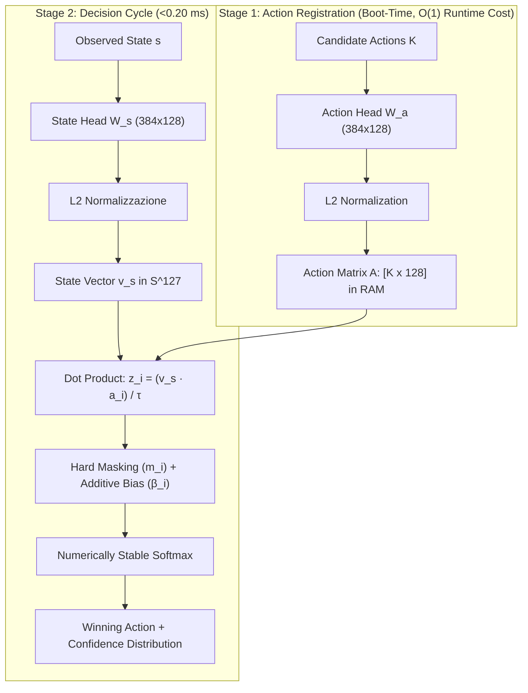

# S1stem

> Sub-millisecond System 1 reflex decision engine in pure JavaScript (ESM) for browser and edge runtimes (<0.20 ms latency, zero external dependencies).

[](test/test_games_verification.js)
[](LICENSE)
[-yellow.svg)]()
[]()
[]()

```javascript
import { S1stemEngine } from './core/s1stem.js';

const engine = new S1stemEngine();
await engine.registerActions([
  { id: 'CRUISE_FORWARD', label: 'Cruise Forward', description: 'Pathway clear ahead. Maintain nominal speed.' },
  { id: 'EVADE_LEFT',     label: 'Evade Left',     description: 'Obstacle ahead. Pivot into open left escape corridor.' },
  { id: 'EMERGENCY_HALT', label: 'Emergency Halt', description: 'Imminent collision barrier detected. Full emergency stop.' }
]);

const telemetry = 'LIDAR Warning: Obstacle detected 0.35m straight ahead. Left flank clear.';
const decision = await engine.choice(telemetry);
console.log(decision.winner, decision.latencyMs); // "EVADE_LEFT", 0.12ms
```

---

## 2. The "Why" (Problem vs. Solution)

### The Problem
Standard autoregressive Large Language Models (8B+ LLMs, System 2) make decisions token-by-token across dozens of self-attention layers. This approach introduces high computational complexity ($\mathcal{O}(N \times L)$), 1.5–3.0 second inference latency, 8–16 GB VRAM consumption, and mandatory dependency on remote GPU server clusters. For autonomous agents, robotics, games, and 60 FPS edge controllers, this bottleneck makes real-time reflexes impossible.

### The Solution
S1stem implements "System 1" reflex decision-making via an asymmetric Two-Tower contrastive architecture mapped onto the unit hypersphere $\mathbb{S}^{127}$. Observed environment states and candidate actions are projected into a congruent latent vector space: runtime evaluation is reduced to an $\mathcal{O}(K \times D)$ dot-product vector scan ($s^T A$), executing in under 0.20 ms directly on CPU/RAM in any modern browser or edge device.

### Key Features
* **Zero external dependencies:** Pure Vanilla JavaScript (ES Modules), natively supported in Node.js $\ge$ 18 and all modern browsers without bundlers, transpilers, or build steps.
* **Deterministic latency < 0.20 ms:** Evaluates $K$ candidates using contiguous `Float32Array` dot-products.
* **Memory footprint < 25 MB:** Deterministic 384d feature hasher with 0 MB cold-start download.
* **Runtime constraint injection:** Hard boolean availability masking ($m_i = 0 \implies -\infty$) and additive logit bias ($\beta_i$) without model retraining.
* **Asymmetric Two-Tower architecture:** Decoupled State head ($W_s$) and Action head ($W_a$) projected onto $\mathbb{S}^{127}$.
* **100% offline & client-side:** Zero API token costs, zero telemetry dispatch, complete data privacy.

---

## 3. Quickstart & Installation (Time to Hello World < 2 minutes)

### Installation
No build step required. Clone the repository:

```bash
git clone https://github.com/Contrastive-LM/CLM.git s1stem
cd s1stem
```

### Prerequisites
* **Node.js** $\ge$ 18.0.0 (CLI execution) or any **modern browser** with ES Modules support (Chrome, Firefox, Edge, Safari).
* **Static HTTP server** (e.g., `python -m http.server 8080` or `npx serve .`) when running in browsers to satisfy ESM CORS policies.

### Minimal Working Example (MWE)
Save this snippet to a file (e.g., `run.js`) in the project root:

```javascript
import { S1stemEngine } from './core/s1stem.js';

// 1. Initialize engine (zero downloads, zero external dependencies)
const engine = new S1stemEngine({ temperature: 0.07 });

// 2. Register candidate actions (projected onto S^127 and cached in RAM at boot)
await engine.registerActions([
  { id: 'CRUISE_FORWARD', label: 'Cruise Forward', description: 'Pathway clear ahead. Maintain nominal forward velocity.' },
  { id: 'EVADE_LEFT',     label: 'Evade Left',     description: 'Obstacle ahead. Pivot into open left escape corridor.' },
  { id: 'EMERGENCY_HALT', label: 'Emergency Halt', description: 'Imminent collision barrier detected. Full emergency stop.' }
]);

// 3. Evaluate unstructured telemetry in sub-millisecond reflex loop
const telemetry = 'LIDAR Warning: Obstacle detected 0.35m straight ahead. Left flank clear.';
const decision = await engine.choice(telemetry);

console.log(`Winning Action : ${decision.winner}`);                  // EVADE_LEFT
console.log(`Confidence     : ${(decision.confidence * 100).toFixed(1)}%`); // 76.4%
console.log(`Latency        : ${decision.latencyMs.toFixed(3)} ms`);  // < 0.20 ms
```

Run with:
```bash
node run.js
```

---

## 4. Configuration & In-Depth

### Configuration Options (`S1stemEngine`)

| Parameter | Type | Default | Description |
| :--- | :--- | :--- | :--- |
| `embeddingDim` | `number` | `384` | Dense input space dimension (deterministic feature hasher). |
| `projectionDim` | `number` | `128` | Latent space dimension on unit hypersphere $\mathbb{S}^{\text{dim}-1}$. |
| `temperature` | `number` | `0.07` | InfoNCE scale parameter $\tau$ for Softmax distribution. |
| `seedState` | `number` | `1337` | Pseudo-random seed for orthogonal State head $W_s$ initialization. |
| `seedAction` | `number` | `7331` | Pseudo-random seed for orthogonal Action head $W_a$ initialization. |
| `weights` | `object` | `null` | Pre-trained weights object `{ stateWeights, actionWeights }`. |
| `stateWeights` | `Float32Array \| Array` | `null` | Direct $384 \times 128$ weight buffer for State head. |
| `actionWeights` | `Float32Array \| Array` | `null` | Direct $384 \times 128$ weight buffer for Action head. |

### `choice(stateText, options)` Options

| Parameter | Type | Default | Description |
| :--- | :--- | :--- | :--- |
| `mask` | `Array<boolean> \| Uint8Array` | `null` | Positional boolean mask: if `false`, action logit is set to $-\infty$. |
| `biases` | `Array<number> \| Object` | `null` | Additive logit bias $\beta_i$ (by index or action ID) for heuristic priors. |
| `temperature` | `number` | `this.config.temperature` | Temperature override for this specific inference call. |

---

### Advanced Use Cases

<details>
<summary>1. Hard Masking & Logit Biasing at Runtime</summary>

Dynamically invalidate dangerous choices and apply heuristic bonuses without retraining:

```javascript
import { S1stemEngine } from './core/s1stem.js';

const engine = new S1stemEngine();
await engine.registerActions([
  { id: 'CRUISE_FORWARD', label: 'Cruise Forward' },
  { id: 'EVADE_LEFT',     label: 'Evade Left' },
  { id: 'EMERGENCY_HALT', label: 'Emergency Halt' }
]);

// Invalidate forward acceleration (wall ahead) and inject heuristic bias
const decision = await engine.choice('Sensors: Obstacle detected ahead in central corridor', {
  mask: [false, true, true],       // CRUISE_FORWARD disabled (-Infinity)
  biases: { 'EVADE_LEFT': 2.0 }    // Additive logit bonus for escape route
});

console.log(decision.winner); // 'EVADE_LEFT'
```
</details>

<details>
<summary>2. Pre-Trained Domain Models (Snake, Tetris, DOOM)</summary>

The repository includes specialized projection matrices for interactive testbeds:

```javascript
import { S1stemEngine } from './core/s1stem.js';
import { DOOM_WEIGHTS, DOOM_ACTIONS } from './examples/doom/doom-weights.js';

const doomAI = new S1stemEngine({ weights: DOOM_WEIGHTS, temperature: 0.07 });
await doomAI.registerActions(DOOM_ACTIONS);

const reflex = await doomAI.choice('Crosshair on enemy target at center range. Line of sight clear.');
console.log(reflex.winner);     // 'FIRE'
console.log(reflex.confidence); // > 80%
console.log(reflex.latencyMs);  // < 0.20 ms
```
</details>

<details>
<summary>3. Interactive Web Testbeds</summary>

Serve the workspace with any local static HTTP server:

```bash
python -m http.server 8080
```

Open in browser:
* **Showcase Hub:** `http://localhost:8080/examples/index.html`
* **Snake Testbed:** `http://localhost:8080/examples/snake/index.html`
* **Tetris Testbed:** `http://localhost:8080/examples/tetris/index.html`
* **DOOM WASM Testbed:** `http://localhost:8080/examples/doom/index.html`
</details>

<details>
<summary>4. Training Domain Weights</summary>

Train custom $W_s$ and $W_a$ projection heads with InfoNCE contrastive triplets:

```bash
node scripts/train_specialized_models.js
```
</details>

---

### Architecture & Trade-Offs



#### Architectural Decisions
* **Asymmetric Two-Tower ($W_s \neq W_a$):** States are descriptive ("Obstacle 2m ahead"), while actions are imperative ("Turn right"). Distinct heads allow optimal cross-domain alignment onto $\mathbb{S}^{127}$.
* **Hypersphere Normalization $\mathbb{S}^{127}$:** With $\|v_s\|_2 = 1$ and $\|v_a\|_2 = 1$, cosine similarity equals the dot product ($\cos(v_s, v_a) = v_s \cdot v_a$), eliminating costly vector norm calculations at runtime.

#### Known Trade-Offs & Limitations
* **Feature Hasher vs. Transformer Backbone:**
  * *Deterministic Hasher (Default):* 0 MB download, < 25 MB RAM, < 0.20 ms latency. Trade-off: token-sensitive, cannot capture complex grammatical structures not present in lexical lemmas.
  * *Transformer Backbone (e.g., MiniLM via ONNX):* Better broad language generalization. Trade-off: ~90 MB download, 150–350 MB RAM, 10–25 ms latency (unsuitable for 60 FPS loops).
* **Discrete vs. Continuous Actions:** Operates over a finite set of $K$ candidate actions. Continuous control outputs (unbounded float coordinates/torques) are not supported.

---

## 5. Closing Sections

* **Contributing:** See [CONTRIBUTING.md](./CONTRIBUTING.md) for local setup, commit conventions, and test runner verification.
* **License:** Licensed under [Apache 2.0](./LICENSE).

